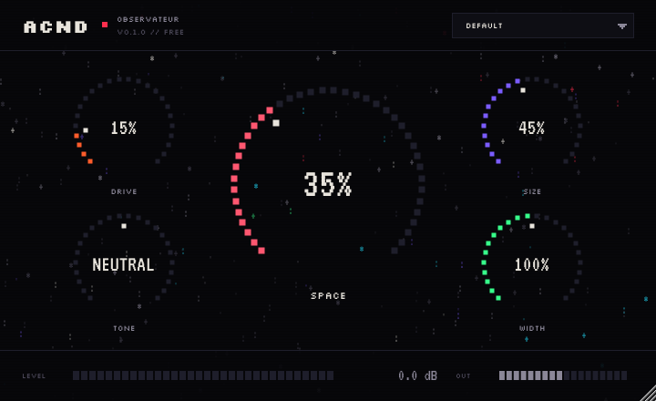

# ACND Observateur

A free audio plugin from ACND. Drive, space and width in one gesture: warm tape-style saturation, a
deep eight-line stereo reverb, and a width control, built to sit on anything from a vocal to a full
mix bus. The interface is the website's ASCII world: a star field that drifts and brightens with
the music.



| Control | What it does |
| --- | --- |
| **DRIVE** | Asymmetric tanh saturation, 2× oversampled. At 0 it adds no saturation at all. |
| **SPACE** | The big knob: how much of the reverb you hear. 35% is a room, 100% puts the source inside the tail. |
| **SIZE** | Decay time, 0.3 s to 30 s. The top of the range is near-infinite. |
| **TONE** | Darker or brighter reverb (damping inside the feedback loop). |
| **WIDTH** | Mid/side width: 0% mono, 100% unchanged, 200% extra wide. |
| **OUT** | Output level, −24 to +12 dB. |

Seven factory presets: Default, Signal, Night Drive, Rain Room, Star Field, Infinite, Clean.

## Formats

| | VST3 | AU | CLAP | LV2 | Standalone |
| --- | :-: | :-: | :-: | :-: | :-: |
| Windows 10+ (x64) | ✓ | | ✓ | | ✓ |
| macOS 10.13+ (Apple Silicon + Intel, one binary) | ✓ | ✓ | ✓ | | ✓ |
| Linux (x64) | ✓ | | ✓ | ✓ | ✓ |

That covers Ableton Live, FL Studio, Cubase, Studio One, Reaper, Bitwig, Logic, GarageBand and
everything else that loads VST3, AU or CLAP. Pro Tools needs AAX, which needs an Avid developer
account and PACE signing; it is not built yet.

## Building

Needs CMake 3.22+ and a C++20 compiler (Visual Studio 2019+, Xcode 12.4+, or GCC/Clang). JUCE and
the CLAP extensions are downloaded at configure time, pinned to exact versions.

```
cmake -S plugin -B build -DCMAKE_BUILD_TYPE=Release
cmake --build build --config Release --parallel
ctest --test-dir build -C Release --output-on-failure
```

Plugins land in `build/Observateur_artefacts/Release/<format>/`. On Linux, first install JUCE's
[system packages](https://github.com/juce-framework/JUCE/blob/master/docs/Linux%20Dependencies.md).
For a universal Mac build add `-DCMAKE_OSX_ARCHITECTURES="arm64;x86_64"`.

## How it is checked

Every push that touches `plugin/` runs [`.github/workflows/plugin.yml`](../.github/workflows/plugin.yml)
on Windows, macOS and Linux:

1. **DSP tests** ([`tests/DspTests.cpp`](tests/DspTests.cpp)) render audio through the real
   processor: the Clean settings stay within −60 dB of the input (they measure about −84 dB),
   silence in gives silence out, every knob at
   maximum on full-scale noise stays bounded at 44.1/96/192 kHz, the tail dies away, mono works,
   oversized host blocks are handled, sessions reload exactly, and every parameter's display text
   parses back to the same value.
2. **[pluginval](https://github.com/Tracktion/pluginval)** at strictness 10 (the maximum) on the VST3.
3. **auval** on the Audio Unit (macOS).
4. The zips are packaged and uploaded as build artifacts.

The CLAP build has also been run through
[clap-validator](https://github.com/free-audio/clap-validator) 0.4.1: 32 passed, 0 failed. Its one
warning is that random bytes passed as a saved state are "accepted". The plugin ignores them, but the
JUCE wrapper cannot report the rejection to the host.

## Releasing

1. Bump `VERSION` in `project(...)` in [`CMakeLists.txt`](CMakeLists.txt).
2. Tag and push: `git tag observateur-v0.1.0 && git push origin observateur-v0.1.0`
3. CI builds everything and opens a **draft** GitHub release with three zips attached. Check it,
   then publish.

Each zip holds every format for that platform, an `INSTALL.txt` with the exact folders to copy into,
and the licence notices.

Never change `PLUGIN_CODE`, `PLUGIN_MANUFACTURER_CODE`, `BUNDLE_ID`, the CLAP id or the parameter ids
in [`source/Parameters.h`](source/Parameters.h) after the first public release. DAWs use them to find
the plugin and its settings inside saved projects; changing them breaks every session that uses it.

## Before a wide release

What separates a plugin people try from one they keep:

- **macOS signing and notarization.** The builds are ad-hoc signed, so they run, but Gatekeeper warns
  on first launch and `INSTALL.txt` has to explain `xattr`. A Developer ID certificate (Apple
  Developer Program, US$99/year) plus notarization removes that, and a signed `.pkg` installer can
  then put each format in the right folder for the user.
- **Windows signing.** Unsigned installers trigger SmartScreen. Azure Artifact Signing is the cheapest
  route where it is available (individuals in the US and Canada); elsewhere an OV code-signing
  certificate.
- **An installer per platform** instead of a zip, so nobody has to find a plug-in folder.
- **AAX** for Pro Tools users, if that audience matters.

## Licensing

- **JUCE 9** is dual-licensed: [AGPLv3](https://www.gnu.org/licenses/agpl-3.0.en.html) or the
  [JUCE licence](https://juce.com/legal/juce-9-licence/). This project is set up for the JUCE licence's
  free **Starter** tier, which covers individuals and businesses under US$20,000 a year in revenue or
  funding and no longer requires a splash screen. Read the EULA yourself before release: whether
  revenue that the plugin brings in indirectly (donations, sponsorship) counts is a question for the
  EULA, not this README. The alternative is to release the source under AGPLv3, which has no revenue
  cap but requires publishing all of the plugin's source code.
- **VST 3 SDK** has been MIT-licensed since VST 3.8 (October 2025). No agreement with Steinberg is
  needed, but the licence text must ship with the plugin; it is in
  [`THIRD_PARTY_NOTICES.md`](THIRD_PARTY_NOTICES.md), which is copied into every release zip.
- **Fonts**: Silkscreen and VT323, both SIL Open Font License; licence texts in `assets/fonts/`.

## Layout

```
plugin/
├── CMakeLists.txt          build, formats, plugin ids, pinned dependencies
├── source/
│   ├── Parameters.h        every parameter, its text formatting, and the factory presets
│   ├── PluginProcessor.*   signal flow: drive → reverb → blend → width → output
│   ├── PluginEditor.*      the 720 × 440 interface, scaled as one piece when resized
│   ├── dsp/Saturator.h     oversampled asymmetric saturation
│   ├── dsp/StarReverb.h    8-line FDN reverb: 4 diffusion stages, Householder feedback
│   └── ui/                 pixel look-and-feel, the ASCII star field, palette and fonts
├── tests/DspTests.cpp      offline tests on the real processor
├── scripts/package.sh      builds the per-platform release zip
├── packaging/INSTALL.txt   the install guide that ships in every zip
└── assets/fonts/           embedded fonts and their licences
```
